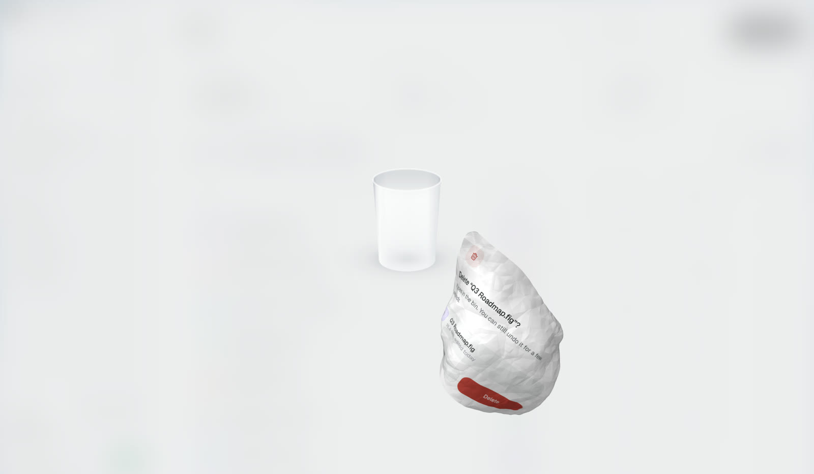
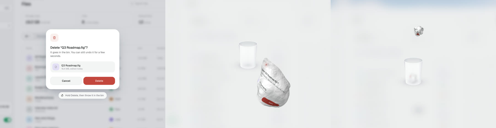

# Crumple

Confirm a delete, and the dialog crumples into a paper ball under your finger. Keep holding, aim, throw it in the bin.



**[Play with it on picker.studio](https://picker.studio/tools/crumple)**: delete a file, cancel a plan, throw the dialog away.

This repo is the engine behind it: one JavaScript file, WebGL2, no dependency, 16 KB gzipped. Point it at any element (a confirm dialog, a card, a whole page), call `grab()` on pointerdown, and listen for the moment the ball lands in the bin.



## What makes it feel like paper

- **It is your dialog.** The real element is captured and swapped for a WebGL copy on the same frame, so you watch your own text fold, not a stock texture.
- **Folds, not noise.** Large flat facets meet in sharp creases, computed per pixel. The sheet closes unevenly, some sides before others, into a lumpy ball where you can still read a word or two.
- **A real throw.** Flick up and the ball flies into the room, shrinking as it goes, in a high lob that drops into the bin. Too soft and it falls short, too hard and it hits the back. It bounces off the rim, rolls on the floor, and you can pick it up again.
- **A bin worth aiming at.** Frosted glass by default: what is inside shows blurred through the wall, sharp where it sticks out of the top. White steel and black steel are one option away.
- **It sounds like paper.** Crumple, whoosh, rim and landing are synthesized on the fly, no audio file.

## Quick start

```html
<div class="dialog" id="dialog">
  <h2>Delete this draft?</h2>
  <button id="cancel">Cancel</button>
  <button id="delete" style="touch-action:none">Delete</button>
</div>

<script src="https://cdn.jsdelivr.net/gh/JuPicker/crumple@1.0.0/vendor/modern-screenshot.js"></script>
<script src="https://cdn.jsdelivr.net/gh/JuPicker/crumple@1.0.0/crumple.min.js"></script>
<script>
  const dialog = document.getElementById("dialog");
  const del = document.getElementById("delete");
  const toss = Crumple.create();

  toss.prepare(dialog);                                   // capture ahead, the first frame is instant
  del.addEventListener("pointerdown", (e) => { e.preventDefault(); toss.grab(dialog, e); });
  del.addEventListener("click", (e) => { if (e.detail === 0) toss.throwInto(dialog); }); // keyboard
  toss.on("score", (ball) => deleteTheDraft());
</script>
```

Or download `crumple.js` and host it yourself. It is a plain script that sets `window.Crumple`, and also works with `require()`. Full example: [`examples/basic.html`](examples/basic.html). React: [`examples/react/Crumple.tsx`](examples/react/Crumple.tsx).

### How a confirm flows

1. **pointerdown on the confirm button**: call `grab(el, event)`. The element hides, the ball forms under the pointer, the stage fades in, the bin appears at the back.
2. **The visitor throws.** A plain click with no flick leaves the ball floating in place, waiting to be thrown (`hover`). A miss leaves it on the floor (`miss`); it can be picked up again.
3. **`score`**: the ball is in the bin. Do the delete, close your dialog, show a toast. The stage fades out on its own.
4. **Undo**: call `discard(ball)` to take the ball out of the bin quietly and bring your element back yourself, or `restore(ball)` for the ball to fly back out and unfold into the element.

### Capturing the element

Crumple needs the element as a canvas. By default it uses [modern-screenshot](https://github.com/qq15725/modern-screenshot) if it finds `window.modernScreenshot` (a copy ships in `vendor/`, MIT). To use something else, pass `snapshot: (el, scale) => Promise<HTMLCanvasElement>`. Call `prepare(el)` once the element is on screen and its fonts are loaded; call it again if its look changes (a hover state, new text).

## Options

`Crumple.create(options)`. Everything is optional.

| Option | Default | |
|---|---|---|
| `binTheme` | `'glass'` | `'glass'` (frosted), `'light'` (white perforated steel), `'dark'` (black brushed steel). |
| `stage` | `{ color: 'rgba(255,255,255,.6)', blur: 22 }` | The backdrop that fades in behind the bin. Use a dark colour with the dark bin, or `false` for none. |
| `assist` | `0.5` | 0 to 1. How much a near miss is bent toward the bin. `0` is pure physics. |
| `sound` | `true` | Synthesized sound effects. Change later with `setSound()`. |
| `binDepth` | `0.5` | How far back the bin stands, as its apparent size (1 = on the screen). |
| `ballSize` | auto | Ball radius in px while held. Default: about 4% of the shorter side of the viewport. |
| `gravity` | auto | px/s². Default: 3.3 x the viewport height. |
| `crumpleTime` | `0.72` | Seconds to crumple. |
| `paperBack` | auto | Colour of the back of the sheet, `[r, g, b]` from 0 to 1. Default: the element background, a bit darker. |
| `shadow` | `{ y: 26, blur: 46, alpha: 0.16, radius: 18 }` | Your element's own shadow, so the swap to WebGL does not flash. |
| `snapshot` | modern-screenshot | `(el, scale) => Promise<HTMLCanvasElement>`. |
| `reducedMotion` | `'auto'` | Follows `prefers-reduced-motion`. When on, the element just fades out and `score` fires. |
| `container`, `zIndex` | `document.body`, `1000` | Where the full-screen overlay is mounted. |
| `onCrumple`, `onThrow`, `onScore`, `onMiss` | | Shortcuts for `on()`. |

## Methods

| Method | |
|---|---|
| `prepare(el)` | Capture an element ahead of time. |
| `grab(el, pointerEvent)` | Crumple `el` under the pointer and let the visitor throw it. |
| `throwInto(el)` | Crumple in place and make a perfect shot. Use it for the keyboard. |
| `discard(ball)` | Take a ball out of the bin, no animation. |
| `restore(ball?)` | The ball flies back and unfolds into its element, which shows again. Resolves `true` when done. |
| `clear()` | Remove every ball and hide the bin. |
| `setSound(on)`, `setAssist(v)` | |
| `on(name, fn)`, `off(name, fn)` | `on()` returns a function that unsubscribes. |
| `destroy()` | Remove the overlay and stop everything. |

## Events

| Event | When |
|---|---|
| `crumple` | The element has been swapped for the sheet, which starts folding. |
| `hover` | Released without a throw: the ball floats, waiting. |
| `pickup` | A floating or missed ball was grabbed again. |
| `throw` | The ball left the hand. Second argument: `{ vx, vy }`, or `{ auto: true }` from `throwInto`. |
| `score` | In the bin. |
| `miss` | On the floor, at rest. |
| `restore`, `restored` | `restore()` started, and finished. |

## Accessibility and fallbacks

- **Keyboard:** Enter or Space on the confirm button can call `throwInto()`, which crumples and scores without aiming.
- **Reduced motion:** the element fades out and `score` fires right away.
- **No WebGL2:** same fade.
- The overlay is `aria-hidden`; your own dialog keeps its roles, labels and focus handling. Announce the result yourself (a toast with `role="status"` works well).
- Put `touch-action: none` on the confirm button so a finger can drag on phones.

## The demo

[`demo/`](demo) is the full page from picker.studio: a file app on a sky, a billing page with springy tabs, the dialog, a stack of undo toasts. Serve the repo root with any static server and open `/demo/`. `?shot=0.5` freezes the crumple at 50% for stills.

## Browser support

Any browser with WebGL2: Chrome, Edge, Firefox, Safari 15 and later, on desktop and mobile.

## Credits

By [Julien Picker](https://picker.studio). MIT license. DOM capture by [modern-screenshot](https://github.com/qq15725/modern-screenshot) (MIT). The demo uses [Geist](https://vercel.com/font) (SIL OFL 1.1).
